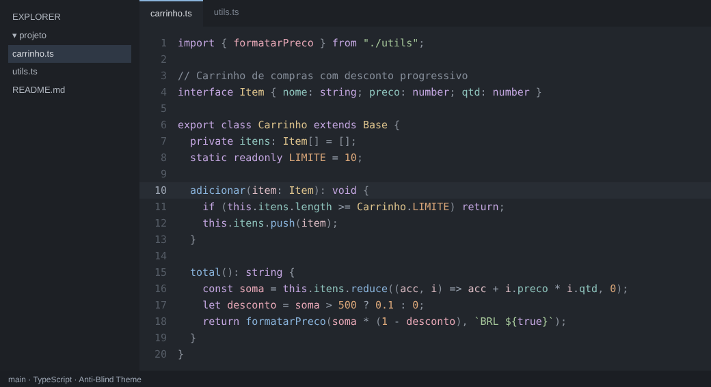

# Linuxzada Calm Dark

Tema dark para o VSCode pensado para **não cansar a vista**, principalmente de quem tem **astigmatismo**.



## Por que essas cores?

Quem tem astigmatismo costuma sofrer com o efeito *halation*: texto muito claro sobre fundo muito escuro parece "borrar" ou "brilhar" nas bordas. Por isso o tema segue algumas regras:

- **Nada de preto puro no fundo**: o editor usa `#22262c`, um cinza-azulado escuro.
- **Nada de branco puro no texto**: o texto padrão é `#c5c9d0`.
- **Contraste moderado**: todas as cores de código ficam entre **7:1 e 9:1** contra o fundo. É o suficiente para ler bem (passa no WCAG AAA) sem o brilho excessivo dos temas de alto contraste (15:1 ou mais).
- **Cores pastel e pouco saturadas**: tons neon cansam mais rápido.
- **Sem itálico e sem negrito**: letras inclinadas ou grossas ficam mais difíceis de focar com astigmatismo.

## Paleta de destaque

| Elemento                             | Cor       | Contraste |
| ------------------------------------ | --------- | --------- |
| Palavras reservadas (`if`, `class`, `return`, `const`…) | `#c3a6e0` lilás  | 7.1:1 |
| Funções e métodos                    | `#8ab4dc` azul   | 7.0:1 |
| Classes, tipos e interfaces          | `#dcc28c` dourado | 8.8:1 |
| Variáveis                            | `#e6a7b6` rosé | 7.7:1 |
| Parâmetros                           | `#dcbcc4` rosé claro | 8.7:1 |
| Propriedades / atributos             | `#8fc4bd` verde-água | 7.8:1 |
| Strings                              | `#a6c79a` verde sálvia | 8.2:1 |
| Números e constantes                 | `#d9a679` laranja suave | 7.0:1 |
| Comentários                          | `#868e9a` cinza | 4.6:1 |
| Texto padrão                         | `#c5c9d0` | 9.2:1 |

O tema também tem suporte a *semantic highlighting*, então em linguagens com LSP (TypeScript, Python, Rust, Go, Java, C#…) a distinção entre classe, função e variável fica ainda mais precisa.

## Instalação

### Pelo script do repositório

O `saving_time_install.sh` instala o VSCode (se precisar), copia o tema para `~/.vscode/extensions` e, se você ainda não tiver um `settings.json`, já deixa o tema e a JetBrainsMono Nerd Font ativados.

### Manualmente

```
cp -r vscode-theme ~/.vscode/extensions/linuxzada-calm-dark
```

Depois reinicie o VSCode, abra a paleta de comandos (`Ctrl+Shift+P`), escolha **Preferences: Color Theme** e selecione **Linuxzada Calm Dark**.

## Dicas extras para astigmatismo

Algumas configurações do `settings.json` que ajudam junto com o tema:

```json
{
  "editor.fontSize": 15,
  "editor.lineHeight": 1.6,
  "editor.letterSpacing": 0.3,
  "editor.fontWeight": "400",
  "editor.cursorBlinking": "solid",
  "editor.renderLineHighlight": "line",
  "workbench.colorTheme": "Linuxzada Calm Dark"
}
```

Fontes com letras bem abertas e espaçadas, como **JetBrains Mono**, **Fira Code** ou **Atkinson Hyperlegible Mono**, também ajudam bastante.
